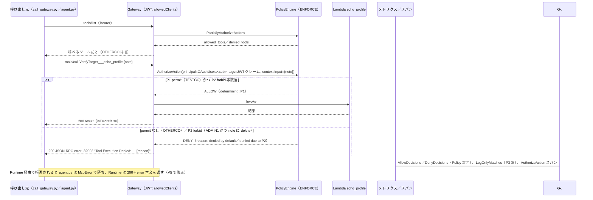

# 検証ログ V4：Gateway Policy（Cedar）— LOG_ONLY → ENFORCE と JWT クレームの tag v1.0

対象：計画書 `計画_追加要件_v1_0.md` 要件 3 の Policy 部分（§3-1／§3-4）、§5 V4 行、§6-3／§6-5。仮決め #10／#17。V4 準備（拒否側の主体・直接呼び出しスクリプト）→ V4a-1（エンジン LOG_ONLY＋P1/P2）→ V4a-2〜4（配列クレーム `agents` の探り）→ V4b（ENFORCE）→ 壊す実験の順。

## V4 合格条件チェックリスト
| # | 条件 | 状態 | 出典 |
|---|---|---|---|
| 1 | `PolicyEngine`（alpha）＋ P1〜P3（raw Cedar）を Gateway に紐付けて deploy できる | **完了**（README の手順そのままでは初回の紐付けが失敗。権限を別ポリシーに分けて解決） | V4a-1 |
| 2 | LOG_ONLY で判定が観測できる（通しつつ記録） | **完了**（メトリクスが主。`tools/call` のスパンは `LOG_ONLY_ASYNC` で判定なし） | V4a-1 |
| 3 | 配列クレーム `agents` の tag 表現（計画 §6-3） | **確定：空白なしの JSON 配列文字列**（`["admin-only","inspect-headers"]`） | V4a-2〜4 |
| 4 | ポリシー単位 `enforcementMode: LOG_ONLY` の実動作（計画 §6-5） | **確定：評価するが判定に数えない。メトリクス `LogOnlyMatches`、スパン `log_only_matched_policies`** | V4a-2、V4b |
| 5 | ENFORCE で TESTCO 許可／OTHERCO 拒否／ADMIN1＋"delete" 禁止（forbid 優先）／`tools/list` の絞り込み | **完了**（拒否の返り方は公式の記述と違い JSON-RPC `error`） | V4b |
| 6 | 壊す実験：`GetPolicyEngine` を外す／P1 削除 | **完了**（前者は約 9.5 分観測しても全拒否にならず＝予想外れ。後者は即時にデフォルト拒否） | V4-壊す実験 |
| 7 | 検証ログ・仮決め #10/#17・計画・コスト表・`整理_システム全体像`・ツール使い方・索引・再開プロンプトの更新 | **完了**（2026-10-18） | 完了時 |

---

## V4-0：準備（2026-10-18）

### 設計判断（分類つき）
| 項目 | 決定 | 分類 | 理由 |
|---|---|---|---|
| 拒否側の主体 | ローカルユーザーを 2 名追加：`local-user-b`（株式会社アザー／管理部 → OTHERCO/ADMIN1、`agents` なし）、`local-user-c`（株式会社テスト商事／管理部 → TESTCO/ADMIN1、`agents=["admin-only","inspect-headers"]`） | 要件固有（検証用） | `local-user-a` の属性は変えない：**CFN の `AWS::Cognito::UserPoolUser` は `UserAttributes` が createOnly**（`describe-type` で確認）＝変更はユーザーの置き換え（`sub` とパスワードが変わる）。Entra に User-B を作るよりユーザー側の作業が少ない |
| Gateway の直接呼び出し | `scripts/call_gateway.py` を新規（V3-3 の使い捨てを昇格） | 要件固有（観測用） | **OTHERCO は `AgentEntitlement` に行が無い → `agents` 非注入 → Runtime 入口で 401** になり Gateway に届かない。Cedar の拒否は直接呼ばないと観測できない |
| トレース文脈 | `call_gateway.py` は毎回 sampled の W3C `traceparent` を付ける。agent.py への追加は「V4a の結果を見て判断」 | — | V3-4 で、トレース文脈の無い呼び出しにはスパンが出なかったため（→ V4 では状況が変わった。V4a-1 参照） |
| P3 の扱い | **ポリシー単位 `enforcementMode: LOG_ONLY`** にし、P1/P2 と**別の deploy** で入れる | 汎用（公式の lifecycle）＋検証の都合 | ACTIVE の permit だと V4b の「P1 削除でデフォルト拒否」が P3 の許可で隠れる。配列 tag の書き方が不明なので、`FAIL_ON_ANY_FINDINGS` で落ちたときにエンジンの紐付けまで巻き戻されないよう分ける |
| エンジンの mode | `const POLICY_ENGINE_MODE: 'LOG_ONLY' \| 'ENFORCE'`（文字列リテラル型） | 汎用 | alpha の `PolicyEngineMode` は **deprecated な alpha Gateway モジュールに属し**、安定版に同等品が無い（L1 の `mode` は `string`）。合成テンプレートは同一 |

### 予想 → 実測：`cdk diff AuthChainIdentityStack`
| 予想 | 実測 |
|---|---|
| `[+] AWS::Cognito::UserPoolUser` ×2 のみ | **一致**。deploy 35 秒。`admin-set-user-password --permanent` を 2 回（パスワードは `out/local-user-{b,c}.password`、0600） |

### `call_gateway.py` の動作確認（AWS 変更なし）
| 送ったもの | 予想 | 実測 |
|---|---|---|
| `--no-auth --method initialize` | 401 `invalid_token`（V3-3 と同じ） | **一致**（"Missing Bearer token"） |
| 期限切れの v3 トークン、`tools/list` | 403 `insufficient_scope` | **一致** |

refresh_token（2026-09-06 発行）は予想どおり失効（`invalid_grant`）。User-A は `get_token.py --idp EntraOIDC` で再ログイン（`out/tokens_userA-oidc_v4.json`）、local-b／local-c は hosted UI でログイン。

---

## V4a-1：エンジン LOG_ONLY ＋ P1/P2（2026-10-18）

### CDK 差分（コード）
`cdk/lib/gateway-stack.ts` に：`agentcoreAlpha.PolicyEngine`（`authchain_engine`）、`(gateway.node.defaultChild as CfnGateway).policyEngineConfiguration = { arn, mode }`、P1（permit：`company_code == "TESTCO"`）・P2（forbid：`department_code == "ADMIN1"` かつ `context.input.note like "*delete*"`）を raw Cedar で `addPolicy`、各ポリシーに `addDependency(verifyTarget)`、出力 `PolicyEngineArn`。

### 予想（Claude が代行）→ 実測：`cdk diff AuthChainGatewayStack`
| 予想 | 実測 |
|---|---|
| `[+] PolicyEngine`、`[+] Policy` ×2（Cedar 中の ARN は `Fn::Join`＋`GetAtt`、`FAIL_ON_ANY_FINDINGS`） | **一致** |
| Gateway に `PolicyEngineConfiguration {Arn, Mode: LOG_ONLY}`、**置き換えにならない** | **一致**（`[~]`。CFN スキーマで Gateway に createOnly が無いことも確認） |
| DefaultPolicy に 2 文（`GetPolicyEngine`→engine、`AuthorizeAction`／`PartiallyAuthorizeActions`→engine＋gateway） | **一致** |
| — | 予想外：alpha の `addPolicy` は **P2 を P1 の後に作る依存を自動で付ける**（ポリシーは直列に作られる） |

### deploy：2 回失敗 → 3 回目で成功（予想外れ）
懸念として挙げていた順序の問題が実際に起きた。DefaultPolicy が Gateway の ARN を参照するため、CFN は「Gateway 更新（紐付け）→ 権限付与」の順に並べる。

| 回 | 構成 | 結果 |
|---|---|---|
| 1 | README どおり（DefaultPolicy に 2 文） | **UPDATE_FAILED**：`Access denied while calling GetPolicyEngine on Policy Engine: …authchain_engine-<id> with Gateway role: … Confirm this role has bedrock-agentcore:GetPolicyEngine permissions`（400 `InvalidRequest`）→ ロールバック |
| 2 | `GetPolicyEngine` だけ別ポリシー（engine ARN のみ参照）にし、Gateway を `DependsOn` | **UPDATE_FAILED**：`User: …assumed-role/<GatewayRole>/GenesisPolicyEngineCheck is not authorized to perform: bedrock-agentcore:AuthorizeAction on resource: …policy-engine/authchain_engine-<id>`（403 `AccessDenied`）→ ロールバック |
| 3 | 2 文とも別ポリシー `GatewayPolicyEngineAccess`（gateway 側の ARN は `gateway/authchain-gateway-*`）、Gateway を `DependsOn` | **成功**（79 秒）：エンジン → 別ポリシー → Gateway 更新 → P1 → P2 |

- ロールバック後はいずれも Gateway `READY`、`policyEngineConfiguration: null`、エンジンは自動削除、`gateway-outputs.json` 不変
- **［実測］紐付け（UpdateGateway）の時点で、AgentCore が Gateway ロールをセッション名 `GenesisPolicyEngineCheck` で引き受けて `GetPolicyEngine` と `AuthorizeAction` を事前検査する**。したがって **alpha README「Using Policy with Stable Gateway」の手順（`gateway.gatewayArn` を参照する grant）では、新規の紐付けは必ず失敗する**
- 対処の代償：`AuthorizeAction` の gateway 側 ARN が具体値から名前の前方一致（`authchain-gateway-*`）に広がる。alpha の `grantEvaluateForGateway` と同じ書き方で、Gateway ロールの trust 条件と同じ範囲（`整理_システム全体像` §5-(b) に逸脱として記録）
- deploy 後：Gateway ID／URL 不変（Runtime の `GATEWAY_URL` はそのまま）、`READY`／`LOG_ONLY`、P1/P2 `ACTIVE`

### 予想（Claude が代行）→ 実測：LOG_ONLY での呼び出し（`call_gateway.py`、`traceparent` 付き）
| # | 主体 | 呼び出し | Cedar の評価（予想） | 応答（予想 → 実測） |
|---|---|---|---|---|
| a | User-A（TESTCO/SALES1） | `tools/call` note="hi" | P1 で ALLOW | 200、`isError=false` → **一致** |
| b | local-b（OTHERCO/ADMIN1） | 同上 | デフォルト拒否 | 200、`isError=false`（通す）→ **一致** |
| c | local-c（TESTCO/ADMIN1） | note="please delete" | P1＋P2 → forbid 優先で DENY | 200（通す）→ **一致** |
| d | local-c | note="hi" | P1 で ALLOW | 200 → **一致** |
| e | 3 名 | `tools/list` | — | 3 名ともツールが見える → **一致**（ただし判定はされている。下記） |
| f | User-A（Runtime 経由） | `--action gateway` | P1 で ALLOW | 200 → **一致**。対照：local-b の Runtime 経由は **401 "Authorization denied"**（Gateway に届かない） |

### 観測（予想 → 実測）
| 面 | 予想 | 実測 |
|---|---|---|
| メトリクス（`AWS/Bedrock-AgentCore`、`OperationName=AuthorizeAction`） | Allow ≥2、Deny 2、`LogOnlyDecisionFlips` 2、`PolicyMismatch` 0 | `AllowDecisions`（`Mode=LOG_ONLY`）**3**（a, d, f。`Policy=p1_permit_testco-<id>` 次元でも 3）、`DenyDecisions` **2**（`Policy=p2…` 次元は 1＝c）、**`DeterminingPolicies` 4／`NoDeterminingPolicies` 1**（b のデフォルト拒否）、**`TotalMismatchedPolicies` 0**。**`LogOnlyDecisionFlips` は出ない（予想外れ）**。名前は公式一覧と一部違う（`PolicyMismatch` ではなく `TotalMismatchedPolicies`） |
| スパン（`aws/spans`）`tools/call` | `aws.agentcore.policy.authorization_decision` と判定を決めたポリシー | **予想外れ**：`AgentCore.Gateway.InvokeTool` に `authorization_decision = "LOG_ONLY_ASYNC"` だけ。`AuthorizeAction` のスパンは出ない（LOG_ONLY では非同期に評価） |
| スパン `tools/list` | — | **同期で判定される**：`AgentCore.Policy.PartiallyAuthorizeActions` に `allowed_tools`／`denied_tools`。local-b だけ `denied_tools: ["VerifyTarget___echo_profile"]`（LOG_ONLY なので一覧は絞らない） |
| スパンとトレース文脈 | f（`traceparent` なし）はスパンが出ない | **予想外れ**：Runtime 経由（f）も、`--no-traceparent` で直接呼んだ対照も**スパンが出た**。Gateway が自分でトレース ID を採番（先頭 8 桁がエポック秒。`6ad4abef` = 11:22:23 UTC）。V3（10-04）と違う。**原因は未確定**（Policy の紐付けで変わった／サービス側の変更のどちらか） |

### 実測と解釈
- **［実測］LOG_ONLY の観測はメトリクスが主**。`AllowDecisions`／`DenyDecisions` に **`Policy` 次元**があり、どのポリシーが判定を決めたかが分かる。c は「P1 の Allow」ではなく「**P2 の Deny**」に数えられる＝**forbid 優先がメトリクスで見える**。`DeterminingPolicies`／`NoDeterminingPolicies`／`TotalMismatchedPolicies` は公式一覧に無い
- **［実測］`tools/call` は LOG_ONLY では非同期評価**（スパンは `LOG_ONLY_ASYNC` のみ）、`tools/list` は同期評価（`PartiallyAuthorizeActions`）
- **［実測］agent.py に `traceparent` を足す必要は無くなった**（Runtime 経由でもスパンが出る）。保留していた判断はこれで「入れない」

---

## V4a-2〜4：配列クレーム `agents` の tag 表現（2026-10-18）

### V4a-2：P3（`like "*inspect-headers*"`、ポリシー単位 LOG_ONLY）
`(p3.node.defaultChild as CfnPolicy).enforcementMode = 'LOG_ONLY'`。diff は `[+] Policy` 1 件（P2 とターゲットの後）。deploy 21 秒、`list-policies` で `enforcementMode: LOG_ONLY`。

| 予想 | 実測 |
|---|---|
| deploy 成功（`getTag` の戻りは文字列型なので `like` は検証を通る［推定］） | **一致** |
| User-A・local-c で当たる／local-b は `hasTag` 偽 | **一致**：**新しいメトリクス `LogOnlyMatches`（`Policy=p3…`）＝ 2**、local-b は Deny 1／`NoDeterminingPolicies` 1 |
| 評価エラーなし | **一致**（`TotalMismatchedPolicies` 0） |
| 最終判定に数えない | **一致**：Allow 2 はどちらも `Policy=p1…`、`DeterminingPolicies` 2（P3 は入らない） |

### V4a-3：形を絞る探り 4 本（同じくポリシー単位 LOG_ONLY）
予想（JSON 文字列のまま tag になる［推定］）：p3b は 2 名、p3c は local-c のみ、p3a・p3d は 0。

| 探り | 条件 | `LogOnlyMatches` | 解釈 |
|---|---|---|---|
| P3 | `like "*inspect-headers*"` | 2（A, c） | 前回と同じ |
| p3a | `== "inspect-headers"` | **0** | 要素 1 つでも素の文字列にはならない |
| p3b | `like "[*"` | **2**（A, c） | **JSON 配列の文字列** |
| p3c | `like "*,*"` | **1**（c。V4b のスパン `log_only_matched_policies` で local-c のみと確認） | 区切りはカンマ |
| p3d | `like "* *"` | **0** | カンマの後に空白なし |

**予想どおり**。deploy 85 秒（4 本が直列に作られる）。

### V4a-4：厳密な書き方の確認
P3 を `like "*\"inspect-headers\"*"`（引用符ごと一致）に更新（`Definition` の in-place 更新、34 秒）。予想 `LogOnlyMatches` 2 → **実測 2**。

### 実測と解釈
- **［実測・確定］配列クレームは OAuthUser の tag として「空白なしの JSON 配列文字列」になる**（User-A：`["inspect-headers"]`、local-c：`["admin-only","inspect-headers"]`）。tag の値そのものは見えないので、探りの当たり方から特定した（計画 §6-3、仮決め #17）
- **本番の書き方**：部分一致の誤ヒット（`inspect-headers-v2` 等）を避けるため **`principal.getTag("agents") like "*\"<agent_key>\"*"`**（V4a-4 で当たることを確認。近い名前を弾くことは未実測）
- **［実測・確定］ポリシー単位 `enforcementMode: LOG_ONLY`**：評価されるが最終判定・`DeterminingPolicies` に入らず、専用メトリクス **`LogOnlyMatches`**（公式一覧に無い）に出る。エンジン単位の LOG_ONLY（`AllowDecisions` の `Mode=LOG_ONLY` 次元）とは別系統（計画 §6-5）

---

## V4b：ENFORCE（2026-10-18）
`POLICY_ENGINE_MODE = 'ENFORCE'` の 1 か所。diff は Gateway の `Mode: LOG_ONLY → ENFORCE` のみ、deploy 29 秒、`READY`／`ENFORCE`。

### 予想（Claude が代行）→ 実測
| # | 主体・呼び出し | 予想 | 実測 |
|---|---|---|---|
| a | User-A、note="hi" | 許可 | **一致**（200、`isError=false`） |
| b | local-b、note="hi" | `result.isError=true`＋`AuthorizeActionException … denied by default` | **判定は一致、返り方が予想外れ**：HTTP 200 の **JSON-RPC `error`** `{"code": -32002, "message": "Tool Execution Denied: Tool call not allowed due to policy enforcement [No policy applies to the request (denied by default).]"}` |
| c | local-c、note="please delete" | forbid で拒否 | **判定は一致**：`… [Policy evaluation denied due to p2_forbid_admin1_delete-<id>]`（**判定を決めたポリシー名が返る**） |
| d | local-c、note="hi" | 許可 | **一致** |
| e | `tools/list` | local-b だけ空 | **一致**（local-b `[]`、A・c はツールあり） |
| f | User-A、Runtime 経由 | 200 | **一致** |
| f' | local-c、Runtime 経由、note="please delete"（追加） | — | **Runtime は HTTP 200、本文 `{"error": "ExceptionGroup: unhandled errors in a TaskGroup (1 sub-exception)"}`**。mcp クライアントが JSON-RPC `error` を `McpError` として送出し、agent.py が処理していない |

### スパン（ENFORCE）
`tools/call` ごとに **`AgentCore.Policy.AuthorizeAction`（CLIENT、`rpc.method=AuthorizeAction`）が同期で出る**。c の例（マスク済み）：
```json
{"aws.agentcore.gateway.policy.mode": "ENFORCE",
 "aws.agentcore.policy.authorization_decision": "DENY",
 "aws.agentcore.policy.authorization_reason": "Policy evaluation denied due to p2_forbid_admin1_delete-<id>",
 "aws.agentcore.policy.determining_policies": ["p2_forbid_admin1_delete-<id>"],
 "aws.agentcore.policy.types": [["p2_forbid_admin1_delete-<id>", "Cedar"]],
 "aws.agentcore.policy.log_only_matched_policies": ["p3_probe_agents_array-<id>", "p3b_probe_json-<id>", "p3c_probe_comma-<id>"],
 "aws.agentcore.policy.mismatched_policies": [],
 "aws.agentcore.policy.temporal.evaluation_invoked": false,
 "aws.agentcore.policy.target_resource.id": "authchain-gateway-<id>", "component_owner": "POLICY"}
```
User-A の許可は `log_only_matched_policies: [p3, p3b]`、local-c は `[p3, p3b, p3c]`。**利用者（`sub`）はスパンに載らない**。

### 実測と解釈
- **［実測・公式との食い違い］Policy の拒否は `result.isError=true` ではなく JSON-RPC `error`（-32002）で返る**（公式 use-gateway-with-policy［D-9］の記述と違う）。文言は `AuthorizeActionException` を含まない
- **-32002 は V3-3 の入口拒否（403 `insufficient_scope`）と同じコード**。違いは HTTP ステータス（Policy 拒否は 200）と文言だけ → エージェントは JSON-RPC コードだけで「トークンの問題」と「認可の拒否」を区別できない
- **拒否理由に判定を決めたポリシー名が出る**［推定：`exceptionLevel: DEBUG` のため。既定レベルでは未確認］
- **Runtime の HTTP 層では Policy の拒否が見えない**（f' は 200）。エージェントが `McpError` を処理しないと落ち、クライアントは本文を読まないと失敗に気づけない → エージェントは `McpError` を受け止めて `{code, message}` を返すべき（agent.py の修正は V5 で。現行 agent.py のコメント「isError=true で返る」は誤り）
- **［実測］ENFORCE では `AuthorizeAction` のスパンに判定・理由・`determining_policies`・`log_only_matched_policies`・`mismatched_policies` がそろう**。誰の呼び出しかはスパンに無いので、トレース ID と呼び出し記録の突き合わせが要る

---

## V4-壊す実験（2026-10-18）
`-c break=noGetPolicyEngine`／`-c break=noP1` の context フラグで壊し、フラグ無しの deploy で戻す（戻した後の diff は差分なし）。

| 実験 | 予想 | 実測 |
|---|---|---|
| 1. Gateway ロールから `GetPolicyEngine` を外す（IAM の 1 文削除、29 秒） | 全員拒否（公式：「欠けると InternalServerException で全拒否」） | **予想外れ：約 9.5 分（20 秒間隔で 25 回）観測しても変化なし**。User-A 許可、local-b はデフォルト拒否のまま（判定は通常どおり）。`get-role-policy` で 1 文が消えていることは確認 |
| 2. P1 を削除（40 秒。同じ deploy で `GetPolicyEngine` を復元） | User-A・local-c("hi") がデフォルト拒否、local-c("delete") は P2、`tools/list` 空、P3 系は救済しない | **全項目一致、削除直後から反映** |

### 実測と解釈
- **［実測・推定］リクエストごとの評価に要るのは `AuthorizeAction`**。`GetPolicyEngine` は紐付け時の事前検査（V4a-1）やエンジン情報の読み込みに使われると推定。長い間隔のキャッシュ再読込で後から全拒否になる可能性は否定できない（観測 9.5 分）。本番への含意：**権限を外しても即座には止まらない（緊急停止の手段にならない）**、権限の欠落は**次の Gateway 更新の事前検査で初めて表面化**する
- **［実測］fail-closed**：permit を消せば即座にデフォルト拒否。ポリシー単位 LOG_ONLY の permit（P3 系）は当たっていても許可にならない（V4-0 の設計意図どおり）

---

### 完了サマリ（V4b の実測シーケンス）


### 本番に向けた含意（`整理_システム全体像` §5-(b)／§7 に反映）
- Policy の紐付けは **Gateway の ARN を参照しない権限を先に付ける**（事前検査 `GenesisPolicyEngineCheck`）。alpha README の例はそのままでは初回 deploy が失敗する
- 配列クレームは JSON 配列文字列の tag。Cedar では **`like "*\"<値>\"*"`** で要素一致を書く
- 新しいポリシーは**ポリシー単位 LOG_ONLY**で本番トラフィックに当てて `LogOnlyMatches` を見てから ACTIVE にできる（エンジン全体を LOG_ONLY に戻さずに済む）
- LOG_ONLY の観測はメトリクス（`Policy` 次元）、ENFORCE はスパン（`AuthorizeAction`）。スパンに利用者は載らない
- エージェントは Gateway の Policy 拒否（JSON-RPC `error` -32002、HTTP 200）を `McpError` として処理し、入口拒否（401／403、同じ -32002 もあり）と HTTP ステータスで区別する
- 拒否理由にポリシー名が出る（DEBUG 時［推定］）。本番は `exceptionLevel` を既定に戻す
- `GetPolicyEngine` を外しても即時停止にはならない。止めるなら ENFORCE のまま permit を外す（即時反映）

---

## 変更履歴
- v1.0（2026-10-18）起票。V4-0（拒否側ユーザー 2 名、`UserAttributes` は createOnly、`call_gateway.py`）、V4a-1（紐付けの事前検査で 2 回失敗 → 別ポリシー化、LOG_ONLY の観測はメトリクス、スパンの自動採番）、V4a-2〜4（配列 tag は空白なし JSON 文字列、ポリシー単位 LOG_ONLY は `LogOnlyMatches`）、V4b（拒否は JSON-RPC error -32002、agent.py は McpError で落ちる）、壊す実験（`GetPolicyEngine` 削除は 9.5 分で変化なし、P1 削除は即時デフォルト拒否）、完了サマリ
