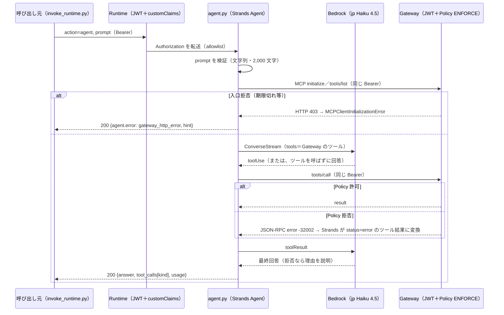

# 検証ログ V5：エージェントの作り直し（McpError 処理 → Strands＋モデル → 計装）v1.0

対象：`整理_システム全体像_v1_0.md` §5-(b)「エージェント実装」「入力検証」行と §7 の未チェック項目、`検証ログ_V4` の「本番に向けた含意」（Policy 拒否の扱い）。V5-0（依存更新のみの再 deploy）→ V5a（LLM なしで `McpError` 処理）→ V5b（Strands＋Bedrock、入力検証）→ V5c（ADOT 計装の要否）の順（2026-10-25 ユーザー決定）。

## V5 合格条件チェックリスト
| # | 条件 | 状態 | 出典 |
|---|---|---|---|
| 1 | 依存更新（PyJWT 2.15.1／mcp 1.30.0）だけで Runtime を再 deploy し、V4 と同じ挙動が保たれる | **完了**（予想 4 点すべて一致） | V5-0 |
| 2 | Policy 拒否（HTTP 200＋JSON-RPC `error` -32002）を `McpError` として受け止めて `{code, message}` を返す。入口拒否（401／403）は HTTP ステータスで区別して再取得を促す | **完了**（Policy 拒否は Runtime 経由で実測。403 は Runtime 経由で到達できないため手元から実測）。併せて依存を推移的依存までロック | V5a |
| 3 | Strands＋Bedrock のモデルで Gateway のツールを同じ Bearer で呼ぶ。入力検証（`prompt` の型・`toolUse` 拒否） | **完了**（Haiku 4.5 jp。Haiku 5.5 はアカウント単位の追加アクセスが必要で切り替え） | V5b-1、V5b-2 |
| 4 | ADOT 計装の要否を判断する | 未着手 | V5c |
| 5 | 検証ログ・計画・コスト表・`整理_システム全体像`・ツール使い方・索引・再開プロンプトの更新 | 未着手 | 完了時 |

---

## V5-0：依存更新のみの再 deploy（2026-10-25）

### 経緯
- main の security-fix（`b214dee`、2026-10-20）で `runtime-code/requirements.txt` が **PyJWT 2.13.0 → 2.15.1、mcp 1.29.1 → 1.30.0** に上がり、`build/` も再生成済み。ただし Runtime は version 3（2026-10-04）のまま＝**稼働中のコードは古い依存**
- V5a でコードを変える前に、依存だけの差分を切り離して deploy し、挙動が変わらないことを確かめる（一度に 1 変更）

### 予想 → 実測：`cdk diff AuthChainRuntimeStack -c forwardAuth=true -c gatewayUrl=<URL>`
| 予想 | 実測 |
|---|---|
| 差分はコード zip だけ（allowlist・環境変数・ロールは不変） | **一致**：`AgentRuntimeArtifact.CodeConfiguration.Code.S3.Prefix` のハッシュだけが変わる。`AuthChainIdentityStack` は差分なし |

### 予想（Claude が代行）→ 実測：deploy と呼び出し
| # | 予想 | 実測 |
|---|---|---|
| 1 | in-place 更新。Runtime ID 不変、version 3 → 4、`requestHeaderAllowlist: ["Authorization"]` と `AGENT_KEY`／`GATEWAY_URL` は維持 | **一致**（deploy 26 秒。`get-agent-runtime` で version 4・allowlist・環境変数 2 つを確認） |
| 2 | User-A の `inspect` は v3 と同じ（`Authorization` が届き、`agents` に `inspect-headers`） | **一致**：`received_header_names` は `Authorization`／`baggage`／`workloadaccesstoken`、TESTCO/SALES1、`agent_key_in_agents: true` |
| 3 | User-A の `action=gateway`（`echo_profile`、`note: hi`）は許可 | **一致**：`tools` は `VerifyTarget___echo_profile` の 1 本、`isError: false`、Lambda の `event` は `{"note":"hi"}`。MCP の `protocol_version` は `2025-06-18`（mcp 1.29.1 のときと同じ） |
| 4 | local-user-c（TESTCO/ADMIN1）の `note: please delete` は P2 で拒否され、agent.py は v3 と同じく落ちる | **一致**：HTTP 200＋`{"error": "ExceptionGroup: unhandled errors in a TaskGroup (1 sub-exception)"}`（`out/runtime_v4b_f2_localC_del.json` と同じ）。**これが V5a の比較基準** |

- トークンは 2026-10-18 の refresh_token から refresh グラントで取り直した（`out/tokens_userA-oidc_v5.json`／`tokens_local-c_v5.json`）。応答は `out/runtime_v5_0{a,b,c}_*.json`

### 実測と解釈
- mcp 1.29.1 → 1.30.0 の更新は、このエージェントの範囲（`streamablehttp_client`／`initialize`／`list_tools`／`call_tool`）では観測できる違いがなかった。Policy 拒否で落ちるのは mcp の版ではなく agent.py の例外処理の問題、という V4 の見立ては変わらない
- 本番に向けた含意：**main 側の依存更新（Dependabot／security-fix）はコードの差分として現れても、Runtime には deploy するまで反映されない**。直接コードデプロイでは「リポジトリの依存」と「稼働中の依存」がずれうるので、依存更新の PR とは別に再 deploy と回帰確認の手順が要る

---

## V5a：`McpError` 処理（LLM なし）と依存のロック（2026-10-25）

### 例外の上がり方（mcp 1.30.0 のソースで確認）
- **Policy 拒否**：Gateway は HTTP 200 で JSON-RPC `error` を返し、`ClientSession.send_request` が `McpError(error)` を投げる（`mcp/shared/session.py`）。`call_tool` の呼び出し元で捕まえられる
- **Gateway 入口の 401／403**：`streamablehttp_client` の裏タスク（`post_writer` → `handle_request_async` → `_handle_post_request` の `raise_for_status()`）で `httpx.HTTPStatusError` が起き、TaskGroup ごと **`ExceptionGroup`** になって `async with` の外へ出る
- V4／V5-0 の `ExceptionGroup: unhandled errors in a TaskGroup (1 sub-exception)` は、`McpError` を `async with` の内側で捕まえていないため、TaskGroup を抜けるときに包まれたもの（anyio 4）

### 設計判断（分類つき）
| 項目 | 決定 | 分類 | 理由 |
|---|---|---|---|
| Policy 拒否 | `call_tool` を `async with` の内側で `McpError` として捕まえ、`call.error = {kind, code, message}`。`code == -32002` なら `kind: policy_denied`、それ以外は `mcp_error` | 要件固有 | 拒否理由（`[Policy evaluation denied due to <policy>-<id>]`）をそのまま呼び出し元に返す。-32002 は Gateway 入口の 403 の本文と同じコードだが、403 は HTTP 層で例外になるのでここには来ない |
| 入口拒否 | `except* httpx.HTTPStatusError` で受け、`{kind: gateway_http_error, http_status, www_authenticate, hint}`。401／403 は「トークンを取り直して再試行」 | 汎用 | 公式（gateway-inbound-auth）と V3 の実測どおり、401（Bearer 無し・非 JWT）と 403（検証失敗）の両方で再取得を促す |
| 想定外 | `except* Exception` → `{kind: unexpected, detail}` | 汎用 | 接続失敗など。これまでどおり中身を観測結果として返す |
| HTTP ステータス | エージェントの応答は 200 のまま、本文で失敗を表す | ［簡略化］ | 観測用の応答形式を V2〜V4 と揃える。本番ではエージェントの API 契約として決める |
| `httpx` | `requirements.in` に `httpx==0.28.1` を明示（mcp 1.30.0 が解決する版と同じ） | 汎用 | 直接 import するものは exact 固定する方針 |
| 依存のロック | `requirements.txt` → `requirements.in`（直接依存の正本）に移し、`uv pip compile`（arm64／3.13／`--only-binary :all:`）で推移的依存まで固定したロックを `requirements.txt` に生成。初回は V5-0 で deploy した束の版を制約にして作った | 汎用 | 下の「推移的依存のずれ」。ロックの名前を `requirements.txt` にしたのは、GitHub の依存グラフ（Dependabot アラート）が pip で読むのが `requirements.txt` だから（公式の対応表に `requirements*.txt` のようなワイルドカードは無い） |

### 予想外：推移的依存のずれ（ロック導入のきっかけ）
- V5a のために `build.sh` を回すと、V5-0（同日）で deploy した束と比べて **boto3／botocore 1.43.115 → 1.43.118、certifi、pycparser 3.11 → 3.12、sse_starlette 3.5.0 → 3.5.1、starlette 1.9.0 → 1.10.0** が上がっていた（`cdk.out` に残る V5-0 のアセットと `build/` の `*.dist-info` を比較）
- V5-0 の `build/` は 10-20 の security-fix のときのもの。`requirements.txt` が直接依存 4 本しか固定していないので、**ビルドのたびに推移的依存が最新に解決され、同じコードでも中身が変わる**
- ユーザー判断：先にロックを入れる（一度に 1 変更を守るため）。ロック後の `build/` は V5-0 のアセットと **`agent.py` 以外すべて同じ**（エントリ一覧と内容を比較）

### deploy 前の手元での確認（Runtime を経由しない）
`agent.invoke` を手元（uv、Python 3.13、ロックと同じ直接依存）から呼び、Gateway の実物に当てた（使い捨てのスクリプト、コミットしない）。

| ケース | 予想 | 実測 |
|---|---|---|
| User-A、`note: hi` | 許可（これまでと同じ） | **一致**：`isError: false`、`event: {"note":"hi"}` |
| local-user-c、`note: please delete` | `call.error.kind = policy_denied`、`ExceptionGroup` なし | **一致**：`{code: -32002, message: "Tool Execution Denied: Tool call not allowed due to policy enforcement [Policy evaluation denied due to p2_forbid_admin1_delete-<id>]"}` |
| 期限切れトークン（10-18 発行の User-A） | Gateway 入口で 403 | **一致**：`{kind: gateway_http_error, http_status: 403, www_authenticate: "Bearer error=\"insufficient_scope\", resource_metadata=\"https://authchain-gateway-<id>…/.well-known/oauth-protected-resource\""}`（V3 と同じ）。期限切れなので最初の要求（`initialize`）で失敗する。このとき `except*` で受けた `ExceptionGroup` は入れ子ではなく、`exceptions[0]` が `HTTPStatusError` そのもの（`initialize` 後の途中で 403 になる場合は未実測） |

### 予想（Claude が代行）→ 実測：deploy と Runtime 経由の呼び出し
| # | 予想 | 実測 |
|---|---|---|
| 0 | `cdk diff` はコード zip の S3 Prefix だけ | **一致**。deploy 26 秒、Runtime version 5、allowlist 維持 |
| 1 | local-user-c、`delete`：HTTP 200、`gateway.call.error.kind = policy_denied`（V5-0 の `ExceptionGroup` が構造化された応答になる） | **一致**：`{kind: policy_denied, code: -32002, message: "Tool Execution Denied … [Policy evaluation denied due to p2_forbid_admin1_delete-<id>]"}` |
| 2 | User-A の `hi`／`inspect` は V5-0 と同じ | **一致**：`isError: false`、`event: {"note":"hi"}`。`inspect` は TESTCO/SALES1、`agent_key_in_agents: true` |
| 3 | 403 の分岐は Runtime 経由では到達できない（Runtime と Gateway が同じクライアントで検証する） | 手元からの確認で代用（上表） |

- 応答は `out/runtime_v5a_{a,b,c}_*.json`

### 本番に向けた含意
- MCP クライアント（mcp 1.x の `streamablehttp_client`）では、**ツールの拒否（`McpError`）と HTTP の失敗（`ExceptionGroup` に包まれた `HTTPStatusError`）で上がり方が違う**。前者は呼び出しの直近で、後者は `async with` の外で `except*` で受ける
- 直接コードデプロイの依存は、**推移的依存までロックしないとビルドが再現しない**。ロックの更新（`uv pip compile` の再実行）→ 再 deploy → 回帰確認を 1 組の手順にする
- security-fix や Dependabot で依存を上げるときは、**`requirements.in` を変えてからロックを作り直す**（`requirements.txt` を直接書き換えると、`.in` に固定した直接依存は次の `uv pip compile` で `.in` の版に戻る。既存のロックは「優先する版」でしかなく `.in` が勝つため）。security-fix スキルは現状この形を扱っていない

---

## V5b-1：実行ロールに Bedrock の呼び出し権限（2026-10-25）

### 着手前の確認（V5b 全体）
| 項目 | 確認結果 | 出典 |
|---|---|---|
| モデルの提供（ap-northeast-1） | Opus 5.5：`jp.`／`global.`、Sonnet 5.5：`global.` のみ、Haiku 5.5：`jp.`／`global.` の推論プロファイル（オンデマンドの直接呼び出しは無く `INFERENCE_PROFILE` のみ） | `list-foundation-models`／`list-inference-profiles` |
| 利用可否 | Opus 5.5・Haiku 5.5 とも `authorizationStatus: AUTHORIZED`、`entitlementAvailability: AVAILABLE` | `get-foundation-model-availability` |
| 価格（$/100 万トークン、入力／出力） | Haiku 5.5：jp $0.11／$0.55、global $0.10／$0.50。Opus 5.5：jp $4.40／$22.00、global $4.00／$20.00（jp は約 10% 高い） | AWS Price List API（`AmazonBedrockFoundationModels`、ap-northeast-1） |
| jp プロファイルの送り先 | Haiku 5.5・Opus 5.5 とも ap-northeast-1 と ap-northeast-3 | `get-inference-profile` |
| Strands の Policy 拒否の扱い | `MCPClient.call_tool_async` は全例外を捕まえて `status: "error"`、`"Tool execution failed: <message>"` のツール結果にする（1.62.0 のソース）。エージェントは落ちず、モデルに拒否文言が渡る想定。-32002 は文字列に埋もれる | strands-agents 1.62.0 `strands/tools/mcp/mcp_client.py` |
| ライブラリ | strands-agents 1.62.0（10-21）／1.61.1（10-15）、`mcp<2.2,>=1.23`。bedrock-agentcore 1.25.0（10-23） | PyPI |

### 設計判断（分類つき）
| 項目 | 決定 | 分類 | 理由 |
|---|---|---|---|
| モデル | **Haiku 5.5、jp 推論プロファイル `jp.anthropic.claude-haiku-5-5`**（ユーザー決定） | 要件固有（データを国内に留める）＋検証用 | 検証の主眼は認証チェーン。費用は V5b 全体で約 $0.1［推定］（Opus 5.5 jp なら $1〜2） |
| フレームワーク | Strands の `BedrockModel`（Converse API） | 汎用 | AgentCore の標準の型。兄弟の agentcore-gateway も同じ（jp の Haiku 4.5） |
| strands-agents の版 | 1.61.1（ユーザー決定） | 汎用 | 公開直後の版を避ける（公開から 1 週間超） |
| 権限 | `bedrock:InvokeModel*` をプロファイル ARN に、送り先 2 リージョンの foundation-model には `bedrock:InferenceProfileArn` 条件付きで許可 | 汎用（公式の例どおり） | プロファイル経由でのみモデルを呼べる形。プロファイルを許可するときは送り先すべての foundation-model も要る（公式の注意書き） |
| 進め方 | V5b-1（IAM のみ）→ V5b-2（依存＋エージェント） | — | 一度に 1 変更 |

### 予想（Claude が代行）→ 実測
| # | 予想 | 実測 |
|---|---|---|
| 0 | `cdk diff` は `AWS::IAM::Policy`（DefaultPolicy）の 2 文追加だけ | **一致** |
| 1 | IAM ポリシーだけが更新され、Runtime は version 5 のまま | **一致**（deploy 26 秒。`lastUpdatedAt` も V5a のまま） |
| 2 | 既存の `inspect`／`gateway` は V5a と同じ | **一致**：`inspect` は 200、local-user-c の `delete` は `policy_denied`（-32002）。応答は `out/runtime_v5b1_*.json` |
| 3 | 権限が効くかは V5b-2 の最初のモデル呼び出しで確かめる | （V5b-2） |

---

## V5b-2：Strands＋モデル（Haiku 4.5）で Gateway のツールを呼ぶ（2026-10-25）

### 予想外：Haiku 5.5 はこのアカウントでは呼べない（モデルアクセスの関門）
| 段階 | 状態 | 呼び出し |
|---|---|---|
| 着手前 | `authorizationStatus: AUTHORIZED`、`entitlementAvailability: AVAILABLE`、**`agreementAvailability: NOT_AVAILABLE`**（Haiku 4.5 は `AVAILABLE`） | 手元・コンソールのプレイグラウンドとも `AccessDeniedException: anthropic.claude-haiku-5-5 is not available for this account …contact AWS Sales` |
| 何度か呼んだ後 | `NOT_AVAILABLE` のまま（`PENDING` にも `ERROR` にもならない）＝初回呼び出しでの自動契約が始まらない | 同上 |
| `create-foundation-model-agreement`（ユーザー承認） | `PENDING` → 約 1 分で **`AVAILABLE`** | **それでも同じ `AccessDeniedException`**（`AVAILABLE` から 3 分以上、30 秒ごとに再試行） |

- 前提条件（Anthropic の初回利用フォーム提出済み、`AdministratorAccess`＝Marketplace 権限あり、契約 `AVAILABLE`）はすべて満たしていた。公式（model-access）の「一部のモデルはアカウント単位の追加アクセスが必要。前提を満たしても `AccessDeniedException` なら AWS Sales へ」に当たると判断［推定：AWS からの確認はしていない］
- ユーザー判断：**Haiku 4.5（`jp.anthropic.claude-haiku-4-5-20251001-v1:0`、jp $1.10／$5.50 per 1M）に切り替え**。Haiku 5.5 の契約は残す（待機コストなし。追加アクセスが通れば `MODEL_ID` を戻すだけ）
- 本番に向けた含意：**モデルを使えるかどうかは IAM（`authorizationStatus`）・初回利用フォーム・契約（`agreementAvailability`）・アカウント単位のアクセスの 4 つの別々の関門**。`get-foundation-model-availability` の `AUTHORIZED` だけでは呼べる保証にならない。新しいモデルを採用するときは、本番アカウントで最小の Converse を事前に通しておく

### 設計判断（分類つき）
| 項目 | 決定 | 分類 | 理由 |
|---|---|---|---|
| 呼び出し口 | `action: "agent"` を**追加**（`inspect`／`gateway` は回帰確認用に残す） | — | 一度に 1 変更。V5a までの比較基準を壊さない |
| 入力検証 | `prompt` は空でない文字列、2,000 文字まで。それ以外は `invalid_input` | 汎用（公式 Runtime security best practices） | 文字列以外（`toolUse` ブロックを含む dict など）を受け付けない＝ツール呼び出しの注入口を作らない |
| MCP クライアント | **リクエストごとに** `MCPClient(url=GATEWAY_URL, headers={"Authorization": <受け取った Bearer>})` | 要件固有（同一 Bearer の透過） | Bearer はユーザーごと・呼び出しごとに違う。共有するとユーザーが混ざる |
| モデル | `BedrockModel(model_id=MODEL_ID)`。`MODEL_ID` は CDK が実行ロールの許可と同じ値を渡す | 汎用 | 権限と設定の値を 1 か所（`runtime-stack.ts` の定数）で結ぶ |
| 拒否の記録 | `AfterToolCallEvent` のフックで各ツール呼び出しの `status` を記録し、文言 `Tool Execution Denied` を含めば `policy_denied` | ［簡略化］ | Strands は `McpError` を `status: "error"` のツール結果に変換し、JSON-RPC のコードは文字列に埋もれる。本番では文言判定ではなく interceptor 等で構造化したい |
| 入口拒否 | `MCPClientInitializationError` の原因（`__cause__`／`__context__`／`ExceptionGroup`）をたどって `HTTPStatusError` があれば V5a と同じ形で返す | 汎用 | Gateway の 401／403 はツール呼び出し前の MCP セッション開始（`initialize`）で起きる |
| モデル側の失敗 | `agent_error`（例外の型とメッセージ）で返す | 汎用 | Haiku 5.5 の `AccessDeniedException` をこれで観測できた |

### deploy 前の手元での確認（Y_admin の権限、Runtime を経由しない）
| ケース | 実測 |
|---|---|
| User-A「こんにちは」 | ツールを 1 回呼んで `success`、要約して `end_turn`（入力 1,763／出力 162 トークン） |
| local-user-c「この記録を delete してください」 | **予想外：モデルが削除の依頼と解釈し、ツールを呼ばずに断った**（`tool_calls: []`）。Policy まで届かない |
| local-user-c「『please delete this record』をそのまま echo して」 | ツールを呼び、Policy P2 で拒否。フックが `policy_denied` を記録し、モデルが拒否と理由を説明して `end_turn` |
| 期限切れトークン | MCP セッション開始で 403 → `gateway_http_error`（原因をたどれた）。Strands の後片付けで `RuntimeWarning` が 1 件（動作に影響なし） |
| `prompt` が dict | `invalid_input` |

### 予想（Claude が代行）→ 実測：deploy と Runtime 経由の呼び出し
| # | 予想 | 実測 |
|---|---|---|
| 0 | `cdk diff`：IAM 2 文の対象を Haiku 4.5 に差し替え、Runtime のコード zip と `MODEL_ID` の追加 | **一致** |
| 1 | Runtime は version 6、IAM も更新 | **一致**（deploy 42 秒。IAM → Runtime の順に更新。allowlist と `MODEL_ID` を確認） |
| 2 | User-A の `agent` が通る＝**Runtime の実行ロールで Haiku 4.5 を呼べる**（V5b-1 の予想 3） | **一致**：ツール 1 回 `success`、`end_turn`（入力 1,734／出力 164） |
| 3 | local-user-c の echo 依頼は `policy_denied` を記録し、モデルが拒否を説明する | **一致**：`tool_calls[0].kind = policy_denied`、回答に拒否とポリシー名 |
| 4 | `gateway`／`inspect` は V5a と同じ | **一致**：`gateway` の delete は `policy_denied`（-32002）、`inspect` は 200 |

- 応答は `out/runtime_v5b2_*.json`。`scripts/invoke_runtime.py` に `--action agent --prompt` を追加

### 完了サマリ（V5b のシーケンス）

### 本番に向けた含意
- LLM エージェントでは、**モデルがツールを呼ばないこと自体が 1 つの層**になる（「delete して」は呼ばれずに断られた）。ただしモデルの判断は保証にならないので、**Gateway の Policy が最後の防御**。Policy の検証は、ツールを確実に呼ばせる入力で行う
- Strands は Gateway の Policy 拒否を例外にせずモデルへ渡す。モデルは**拒否理由（ポリシー名）を利用者にそのまま説明する** → 本番は `exceptionLevel` を既定に戻す（V4 の含意を裏づけ）
- Gateway の入口拒否はツール呼び出し前（MCP セッション開始）に起きる。エージェントは「モデルを呼ぶ前の失敗」として扱い、トークンの取り直しを促す
- モデルの採用前に、本番アカウントで最小の Converse を通す（上の「モデルアクセスの関門」）

---

## 変更履歴
- v1.0（2026-10-25）起票。V5-0（依存更新のみの再 deploy、予想 4 点一致、Runtime version 4）
- v1.0 追記（2026-10-25）V5a（`McpError`／`except* httpx.HTTPStatusError`、推移的依存のずれ → ロック導入、手元からの 403 実測、Runtime version 5）
- v1.0 追記（2026-10-25）V5b-1（着手前の確認：提供モデル・価格・送り先・Strands の拒否の扱い。Haiku 5.5 jp の呼び出し権限を IAM のみで deploy）
- v1.0 追記（2026-10-25）V5b-2（Haiku 5.5 のモデルアクセスの関門 → Haiku 4.5 に切り替え、`action: "agent"`、Strands の拒否の扱い、モデルがツールを呼ばない層、Runtime version 6、完了サマリ）
